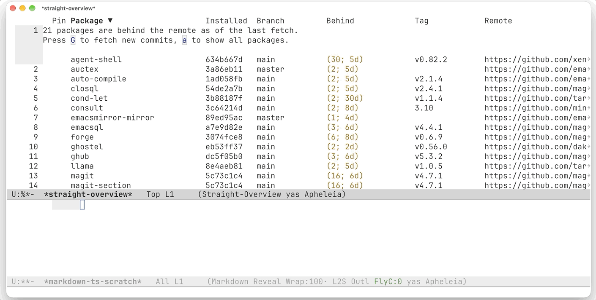

# straight-overview

An Emacs package for upgrading [straight.el](https://github.com/radian-software/straight.el)
packages one by one instead of all at once.

Disclosure: Written with AI assistance (Claude). Every change is reviewed
and tested by the author, and design decisions are the author's.

`M-x straight-overview` lists your straight packages and how many commits and
days each is behind its upstream branch. From that list you can:

- **fetch** all remotes in parallel, in the background, while you keep
  working;
- **pull** only the packages you mark. Each package is pulled after the
  marked packages it depends on, and a package whose dependencies are
  missing or older than its `Package-Requires` asks for is skipped with a
  warning;
- **pin** a package at its installed commit, so it cannot be marked for
  update, and later reset it to that commit;
- **read the changelog** of the commits a pull would bring in.



straight.el has `straight-pull-all`, which pulls every package, and
`straight-pull-package`, which pulls one package by name. Neither tells you
which packages have new commits. `straight-overview` shows that, then calls
`straight-pull-package` for the packages you mark.

## The list

`M-x straight-overview` opens a buffer with one row per package that straight
cloned with git:

| # | Pin | Package | Installed | Branch | Behind | Tag | Remote |
|---|-----|---------|-----------|--------|--------|-----|--------|
| 1 |     | consult | a1b2c3d4  | main   | (3; 14d) | 1.9 | https://github.com/minad/consult |

- **#** numbers the rows in the current sort order.
- **Pin** shows `*` for a pinned package.
- **Installed** is the checked-out commit.
- **Branch** is the branch straight tracks: the recipe's `:branch`, else the
  checked-out branch.
- **Behind** is `(<commits>; <time>)`: how many commits the upstream branch
  has that your checkout does not, and how much newer its last commit is
  than yours. Sorting on this column sorts by time.
- **Tag** is the nearest tag (`git describe --tags`).
- **Remote** is the repository's web page.

By default only packages that are behind are listed; <kbd>a</kbd> shows all
packages. A banner above the table says how many packages are behind the
remote as of the last fetch.

Opening the list does not contact the remotes: it reads the local git refs,
which are as recent as the last fetch. Each package needs two git calls,
`git for-each-ref` and `git describe`. The package runs them for all packages
in parallel, at most `straight-overview-jobs` processes at once, and Emacs
waits for the last one: 0.4 s for 111 packages on an 8-core Mac.
<kbd>C-g</kbd> stops the scan and the git processes still running.

## Fetching

<kbd>G</kbd> runs `git fetch` in every repository, in the background. Each
repository is fetched once, also when several packages share it. At most
`straight-overview-fetch-jobs` fetches run at once (103 repositories take
3.5 s with 16 at once), and Emacs stays usable meanwhile. The banner shows
how many repositories are done. When the last fetch ends, the list refreshes
and the banner names the packages whose fetch failed, timed out (after
`straight-overview-fetch-timeout` seconds), or needed credentials. Pressing
<kbd>G</kbd> while a fetch runs offers to cancel it.

The parallel fetches cannot ask for a username, password or passphrase: a
remote that asks fails instead of waiting. If
`straight-display-subprocess-prompts` is non-nil (the straight option that
lets git ask you for credentials), the package asks once after the last
fetch whether to enter them, then fetches those repositories again one after
another and reads each prompt in the minibuffer. If the option is nil
(straight's default), the banner lists those repositories. Credentials stored
in a git credential helper, such as the macOS keychain, are used without a
prompt.

<kbd>G</kbd> runs `git fetch <remote>` directly instead of
`straight-fetch-all`. `straight-fetch-all` first checks each repository
(remote URLs, uncommitted changes, a merge in progress, the checked-out
branch) and asks how to proceed when a check fails. A fetch only updates
remote refs, so it does not need those checks. Pulling still goes through
`straight-pull-package` and its checks.

## Pulling

Mark packages with <kbd>m</kbd> (or all outdated ones with <kbd>M</kbd>), then
press <kbd>x</kbd>. The package calls `straight-pull-package` for each marked
package, one at a time; Emacs waits until the last pull ends, then rescans.
If `straight-overview-build-on-pull` is non-nil, each package is also rebuilt
with `straight-rebuild-package`; otherwise straight rebuilds the modified
repos on the next Emacs restart.

Before pulling, <kbd>x</kbd> checks dependency versions with package.el's
rules; where package.el would refuse to install a package, <kbd>x</kbd>
skips it:

1. It reads each marked package's `Package-Requires` (or its `-pkg.el`) at
   the upstream tip, which is the version the pull would install. As in
   package.el, a bare `foo` or `(foo)` requires `foo` at any version. A
   package whose requirements cannot be read, or whose own version header
   is not a version, is skipped with a warning.
2. It orders the pulls so that each package is pulled after the marked
   packages it depends on.
3. Just before pulling a package, it reads the `Version` header of each
   dependency (or its `Package-Version` header, which takes precedence):
   at the upstream tip if the dependency lives in the same repository,
   otherwise at HEAD, which already includes the dependencies pulled
   earlier in the batch. As in `package-vc`, a dependency without a
   version header has version 0. Emacs and built-in packages are checked
   with `package-built-in-p`.
4. A package whose dependency is not installed, or older than required, is
   not pulled; `*Warnings*` gets a line such as
   `forge was not pulled; it requires magit 4.7 (installed: 4.6.0)`.

package.el, when a requirement is not met, installs a newer version from a
package archive, or installs nothing. straight has no archive to install
from, so <kbd>x</kbd> skips only the packages whose requirements are not met
and pulls the others. To upgrade a package together with a dependency it
needs, mark both.

<kbd>X</kbd> (or <kbd>C-u x</kbd>) runs the same check in the same order,
but also pulls the packages <kbd>x</kbd> would skip; `*Warnings*` gets a line
such as `forge was pulled although it requires magit 4.7 (installed: 4.6.0)`.

## Pinning

<kbd>P</kbd> pins the package at point: the pin records the installed commit,
and the package cannot be marked for update (<kbd>m</kbd> refuses,
<kbd>M</kbd> skips it). Pinned rows are greyed out. <kbd>F</kbd> removes the
pin. <kbd>R</kbd> resets a pinned package to its pinned commit: it checks out
the branch straight tracks and runs `git reset --hard` to that commit, after
asking, because this discards uncommitted changes in the repository.

Pins are saved to `straight-overview-pinned-file` when it is set; otherwise
they last until Emacs exits. They are independent of straight's lockfile
(`straight-freeze-versions`) and do not affect `straight-pull-all`.

## Changelog

<kbd>c</kbd> lists the commits between the installed commit and the upstream
tip (`HEAD..upstream`). With Magit installed, they open in a `magit-log`
buffer, and pressing <kbd>c</kbd> on another package reuses that window.
Without Magit, they open as a plain `git log --oneline` listing.

## Installation

`straight-overview` needs straight.el and Emacs 29.1 or later. With
`use-package`:

```elisp
(use-package straight-overview
  :straight (:host github :repo "alberti42/straight-overview")
  :commands (straight-overview))
```

Or directly:

```elisp
(straight-use-package
 '(straight-overview :host github :repo "alberti42/straight-overview"))
```

## Keys

| Key | Action |
|-----|--------|
| <kbd>m</kbd> | mark the package at point for update |
| <kbd>u</kbd> | unmark |
| <kbd>U</kbd> | unmark all |
| <kbd>M</kbd> | mark all outdated packages |
| <kbd>x</kbd> | pull the marked packages, after checking their dependencies (and rebuild, if enabled) |
| <kbd>X</kbd> | pull the marked packages, also those whose dependencies are not met |
| <kbd>P</kbd> | pin the package at point at its installed commit |
| <kbd>F</kbd> | remove the pin |
| <kbd>R</kbd> | reset the package at point to its pinned commit |
| <kbd>c</kbd> | show the commits a pull would bring in |
| <kbd>o</kbd> / <kbd>RET</kbd> | open the package's repository in a browser |
| <kbd>a</kbd> | show all packages / only outdated ones |
| <kbd>g</kbd> | rescan the local refs (no fetch) |
| <kbd>G</kbd> | fetch all remotes in the background, then rescan; during a fetch, offer to cancel it |

The keys of `tabulated-list-mode` also work, for example clicking a column
header to sort.

## Customization

| Variable | Default | Meaning |
|----------|---------|---------|
| `straight-overview-fetch-on-open` | `nil` | `nil` opens the list without fetching; `ask` asks; `t` always fetches. The fetch runs in the background, as with <kbd>G</kbd>. `C-u M-x straight-overview` fetches once regardless. |
| `straight-overview-show` | `outdated` | `outdated` lists only packages that are behind; `all` lists every package. <kbd>a</kbd> switches. |
| `straight-overview-hl-line` | `t` | When non-nil, highlight the current row with `hl-line-mode`. |
| `straight-overview-changelog-use-magit` | `t` | When non-nil and Magit is loaded, <kbd>c</kbd> opens a `magit-log` buffer. `nil` always uses the plain `git log` listing. |
| `straight-overview-build-on-pull` | `nil` | `nil` pulls only; straight rebuilds the modified repos on the next Emacs restart. `t` also runs `straight-rebuild-package` right after each pull, and after <kbd>R</kbd>. |
| `straight-overview-jobs` | `nil` | Maximum number of git processes run at once while scanning local refs. `nil` uses the number of processors (`num-processors`). |
| `straight-overview-fetch-jobs` | `16` | Maximum number of `git fetch` processes run at once. A fetch mostly waits on its server, so more fetches than processors still pay off. |
| `straight-overview-fetch-timeout` | `30` | Seconds after which a single repository's fetch is stopped and reported as timed out. `nil` means no limit. |
| `straight-overview-pinned-file` | `nil` | File where pins are saved, as an `.eld` alist of `(name . commit)`. `nil` keeps pins until Emacs exits. |

The overview opens in the selected window. It is shown through
`display-buffer`, so `display-buffer-alist` can place it elsewhere; the buffer
is named `*straight-overview*`. For example, to open it in a side window at
the bottom:

```elisp
(add-to-list 'display-buffer-alist
             '("\\`\\*straight-overview\\*\\'"
               (display-buffer-in-side-window)
               (side . bottom) (window-height . 0.4)))
```

## Limitations

- **No stable releases.** straight tracks one branch per package. **Behind**
  compares with that branch's tip; **Tag** shows the nearest tag, and is
  blank for untagged packages.
- **Version headers are often stale.** Like package.el for packages from
  git (`package-vc`), GNU ELPA or MELPA Stable, the dependency check trusts
  each package's `Version` header. Many packages bump it only at releases,
  so a dependency can pass the check while missing commits the dependent
  needs, or fail it while having them.
- **straight.el is skipped.** Its header says `Version: prerelease`, which
  is not a version, so package.el would not install it and <kbd>x</kbd> does
  not pull it. Pull it with <kbd>X</kbd>.
- **Shallow clones.** Commit counts and changelogs assume full clones,
  straight's default (`straight-vc-git-default-clone-depth` is `full`). For a
  shallow clone they can be too low.

## Acknowledgements

The package started from a Reddit discussion about upgrading packages
selectively.

- **[subtree-package](https://github.com/djr7C4/subtree-package)** by David J.
  Rosenbaum. Its package list shows how far each package is behind upstream
  as `(<commits behind>; <time behind>)`; the **Behind** column copies that
  format. subtree-package vendors packages into your own repository as git
  subtrees; `straight-overview` keeps straight.el as the package manager.
- **[straight.el](https://github.com/radian-software/straight.el)** by Radian
  LLC. Pulls, rebuilds and lockfiles are straight's; this package calls them.
- **Dired** and **package.el's `list-packages`**, for the mark-then-execute
  keys (<kbd>m</kbd>, <kbd>u</kbd>, <kbd>U</kbd>, <kbd>x</kbd>).

## Development

`make test` runs the ERT tests in `test/straight-overview-tests.el` in a
batch Emacs. The tests create git repositories in a temporary directory and
stub straight.el when it is not on the `load-path`, so they need only Emacs
and git. `make lint` runs `check-parens` and `checkdoc`.

## License

[GNU General Public License v3.0 or later](LICENSE).

Copyright (C) 2025-2026 Andrea Alberti.
